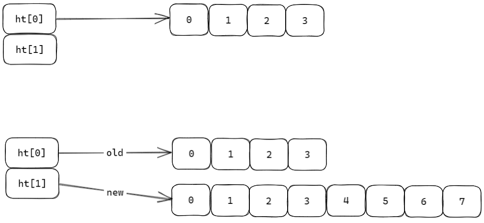
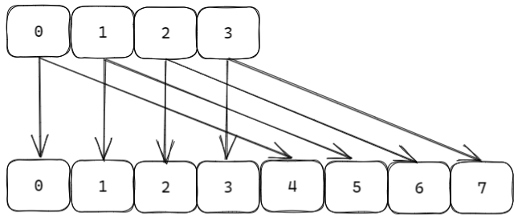

# CSDN文章

> 原文链接: [https://blog.csdn.net/2301_81287715/article/details/153396539](https://blog.csdn.net/2301_81287715/article/details/153396539)


#### 文章目录

- [CSDN文章](#csdn文章)
      - [文章目录](#文章目录)
  - [一、哈希表机制](#一哈希表机制)
    - [1.1 哈希表基础原理](#11-哈希表基础原理)
    - [1.2 哈希冲突与负载因子](#12-哈希冲突与负载因子)
  - [二、哈希表的扩缩容机制](#二哈希表的扩缩容机制)
    - [2.1 扩容机制](#21-扩容机制)
    - [2.2 缩容机制](#22-缩容机制)
  - [三、渐进式 Rehash（核心机制）](#三渐进式-rehash核心机制)
    - [渐进式 rehash 过程中，是否会触发新的扩容或缩容](#渐进式-rehash-过程中是否会触发新的扩容或缩容)
  - [四、源码解析](#四源码解析)
    - [4.1 哈希表的核心结构体](#41-哈希表的核心结构体)
    - [4.2 扩容触发条件](#42-扩容触发条件)
    - [4.3 缩容触发条件](#43-缩容触发条件)
    - [4.4 渐进式 rehash](#44-渐进式-rehash)


## []()一、哈希表机制


### []()1.1 哈希表基础原理

`哈希表（dict）`是 Redis 中用于组织数据的核心结构，其底层实现为` “数组 + 链表” 的组合（拉链法）`。具体来说，底层是一个指针数组，数组的每个槽位（索引位置）对应一个单链表，用于存储哈希冲突的元素。

**数据的存储和查询过程**：

- 先将键（key）通过哈希函数生成一个 64 位整数；
- 然后，用这个整数对哈希表数组的长度进行取余，得到数组的索引值； 
  实际中通过位运算`hash & (size - 1)`实现，效率更高
- 最后，根据索引值在数组中找到对应的槽位
- 若存在哈希冲突（多个 key 映射到同一槽位），则通过链表依次存储这些元素。

这种方式使得数据的查询、插入、删除操作的平均时间复杂度为 O (1)，但前提是哈希冲突不严重（即元素在数组槽位分布均匀）；


### []()1.2 哈希冲突与负载因子

在哈希表中，多个 key 的哈希值可能落到同一个槽位，这种情况称为 **哈希冲突**。 Redis 通过“拉链法”解决冲突：相同槽位的元素用单链表链接起来。

为了平衡性能与空间利用，Redis 引入 **负载因子（Load Factor）**：

```cs
负载因子 = used / size

```

- `used`：哈希表中已有元素数量
- `size`：哈希表数组的长度（2 的幂次方）

当负载因子较小时（如 < 0.5），元素在数组中分布稀疏，哈希冲突的概率低，查询效率高，但空间利用率低；当负载因子较大时（如 > 1），元素分布密集，哈希冲突增多，链表长度变长，查询效率下降，查询时间从 O (1) 趋近于 O (n)（n 为链表长度）。

Redis 会将负载因子控制在 1 附近，即平均每个槽位只放一个元素，以确保高效的 O(1) 查找性能。


## []()二、哈希表的扩缩容机制

Redis 的哈希表容量是动态调整的。 通过 **扩容** 和 **缩容** 保持负载因子合理，从而维持高效的查询性能与内存利用。


### []()2.1 扩容机制

**1. 触发条件** 当 **负载因子 > 1**（元素过多，冲突加剧）时，Redis 触发扩容。

特殊情况（fork 操作时）：

- 如果 Redis 正在执行fork操作，如 **RDB/AOF 持久化**，会**暂缓扩容**，以避免写时复制（COW）开销；
- 但如果负载因子超过 **5**，仍会强制扩容，保证性能。

**2. 扩容方式**

- 扩容后数组大小为原来的 **2 倍**；
- 元素将重新哈希并分配到新的槽位；
- 为避免一次性迁移造成阻塞，Redis 采用 **渐进式 rehash**（见下文）。


### []()2.2 缩容机制

当哈希表元素大幅减少时，Redis 触发缩容，释放空闲空间，避免内存浪费。

**1. 触发条件** 当 **负载因子 < 0.1** 时，触发缩容。

**2. 缩容方式**

- **数组长度调整**：新数组的长度会调整为 “刚好能容纳当前元素个数”的最小 2 的幂
- 举例：元素数量为 9，大于 9 的最小 2 的幂是 16（2^3 = 8 < 9，2^4 = 16），则新数组长度为 16


## []()三、渐进式 Rehash（核心机制）

扩缩容需要把所有元素迁移到新哈希表。如果一次性迁移所有元素（全量 rehash），会导致 Redis 单线程长时间阻塞（无法处理其他命令），因此 Redis 采用 “渐进式 rehash”，将迁移任务拆分到多个步骤中。
- **渐进式哈希通过双哈希表结构实现：**
  ht[0]：主哈希表，日常存储数据。
  ht[1]：临时哈希表，仅在Rehash时使用，用于承接ht[0]迁移的数据。
```
typedef struct dict {
    dictType *type;          // 类型方法集合（哈希函数、比较函数等）
    void *privdata;          // 私有数据（如哈希种子）
    dictht ht[2];            // 核心：两个哈希表（ht[0]和ht[1]）
    long rehashidx;          // Rehash进度（-1表示未进行）
    int16_t pauserehash;     // Rehash是否暂停（持久化时可能暂停）
} dict;

```


- **基本步骤**：Redis 同时维护两个哈希表：`ht[0]`（旧）和 `ht[1]`（新表 + 迁移数据）。迁移时，将`ht[0]`中元素重新计算哈希值，根据`ht[1]`的 size 确定新槽位，再迁移到`ht[1]`。
- **渐进方式**： 
  分治策略：每次执行增、删、改、查操作时，顺带迁移`ht[0]`中的部分槽位定时器辅助：Redis 会在定时器任务中执行 rehash，每次最多运行 1 毫秒，最多迁移 100 个槽位，避免阻塞主线程。
- **所有槽位迁移完成后，释放旧表空间**：当`ht[0]`中所有元素迁移到`ht[1]`后，将`ht[1]`赋值给`ht[0]`，释放`ht[0]`原空间，`ht[1]`置空，rehashidx 设为 - 1。

**Rehash 过程**：



- 创建新哈希表 `ht[1]`，大小是旧表的两倍；
- 设置 `rehashidx = 0`；
- 每次执行命令或定时任务时： 
  将 `ht[0][rehashidx]` 的所有元素迁移到 `ht[1]`；`rehashidx++`；
- 当所有槽位迁移完毕： 
  `ht[0] = ht[1]`；`ht[1]` 置空，`rehashidx = -1`。

**补充：**

扩容后，原ht[0]的元素需重新计算槽位，用新数组长度的size-1做位运算，迁移到ht[1]。举例：原数组长度为 4（槽位 0-3），扩容后为 8（槽位 0-7），原槽位 0 的元素（哈希值 & 3=0），新槽位要么是 0（哈希值 & 7=0），要么是 4（哈希值 & 7=4）。




### 从用户角度看：两个触发渐进式扩容的例子

上面讲的都是内部结构，这里从**命令行 / 业务代码**的角度，看一看“用户是如何间接触发渐进式扩容”的。

#### 1）单个大哈希对象触发渐进式扩容

假设有一个存储用户资料的哈希键：

```bash
HSET user:1001:profile f1 v1
```

- `HSET`：操作的是 Redis 的 **hash 抽象类型**；
- `user:1001:profile`：这是 key，表示“id 为 1001 的用户资料对象”；
- `f1`：这是 hash 里的 field，可以理解为“这个用户资料对象里的某一个属性名”，比如 `nickname`、`age` 等；
- `v1`：这是 field 对应的值，比如昵称具体内容、年龄数字等。

如果你的业务一直在往同一个 hash 里加字段，例如：

```bash
HSET user:1001:profile f2 v2
HSET user:1001:profile f3 v3
...
HSET user:1001:profile f100000 v100000
```

随着 field 数量越来越多，这个 hash 底层使用的哈希表（dict）里的元素数量 `used` 变大，当负载因子 `used / size` 超过阈值（大致接近 1，具体策略见后文源码部分）时，就会触发**扩容 + 渐进式 rehash**：

- Redis 给这个 hash 底层再分配一个更大的 `ht[1]`；
- 设置 `rehashidx` 开始迁移旧桶；
- 之后每一次对这个 hash 的 `HSET` / `HGET` / `HDEL` 等操作，都会顺带迁移一部分桶，直到所有数据从旧表 `ht[0]` 搬到新表 `ht[1]`。

从用户视角看：

- 所有命令依然是正常的 `HSET/HGET`，语义一点都没变；
- 只是这段时间内，每个操作会“顺带干一点搬桶的活”，这就是**渐进式扩容在悄悄发生**。

#### 2）整个 keyspace（数据库字典）触发渐进式扩容

Redis 每个数据库本身有一个“总字典”，通常记为 `db->dict`，用来存放：

```text
key   ->  value（RedisObject）
```

比如你在导入大量数据时，会写很多类似这样的命令：

```bash
SET user:1 "..."
SET user:2 "..."
...
SET user:10000000 "..."
```

对初学者来说，这里容易产生两个疑惑：

- **第一个：这些命令使用的抽象类型是什么？**  
  `SET` 操作的是 Redis 的 **string 抽象类型**，也就是：
  - `user:1`、`user:2` 是 key；
  - `"..."` 是对应的 string 值（可以是 JSON、序列化后的对象文本等）。

- **第二个：渐进式扩容到底发生在哪一层？是 string 里面吗？**  
  不是。这里的渐进式扩容发生在 **数据库字典 `db->dict` 这一层**，它本质上也是一个哈希表（dict）：
  - `db->dict` 的 key 是所有用户写入的 key（比如 `user:1`、`order:xxx`）；
  - `db->dict` 的 value 是指向各种 RedisObject 的指针（string / hash / list / zset 等）。

当你不断执行大量 `SET` 时：

- `db->dict` 里存放的键值对数量快速增加，`used` 变大；
- 当 `used / size` 超过扩容阈值时，Redis 会给 `db->dict` 分配新的 `ht[1]`，并启动渐进式 rehash；
- 之后每一次普通命令（`SET`/`GET`/`DEL` 等）在访问 `db->dict` 时，都会顺带迁移一部分桶，直到 rehash 完成。

所以：

- **命令层面**：你只是在用很普通的 `SET` 操作 string 类型；
- **内部实现层面**：是整个“数据库字典”这个哈希表在做渐进式扩容，保证大量 key 写入时性能尽可能平滑、避免一次性全量 rehash 带来的长时间阻塞。


### []()渐进式 rehash 过程中，是否会触发新的扩容或缩容

不会。因为 rehash 尚未完成时，启动新的扩缩容会导致数据迁移冲突（如ht[1]同时用于旧 rehash 和新扩缩容），增加开销与复杂度，因此 Redis 会等待当前 rehash 完成后，再处理新的扩缩容需求。


## []()四、源码解析


### []()4.1 哈希表的核心结构体

**（1）字典节点结构** `dictEntry`：存储单个键值对及链表指针

```c
typedef struct dictEntry {
    void *key;   // 存储键
    union {      // 存储值，支持多种类型（指针、整数、浮点数）
        void *val;
        uint64_t u64;
        int64_t s64;
        double d;
    } v;
    struct dictEntry *next; // 指向下一个节点，用于解决哈希冲突（形成链表）
} dictEntry;

```

**（2）哈希表结构** `dictht`：管理数组及元素统计信息

```c
typedef struct dictht {
	dictEntry **table; // 哈希表数组（每个元素是指向dictEntry的指针）
	unsigned long size; // 数组长度（始终为2的幂，如4、8、16）
	unsigned long sizemask; // 用于计算槽位索引，值=size-1（如size=4时sizemask=3）
	unsigned long used; // 已存储的键值对总数（用于计算负载因子）
} dictht;

```

**（3）字典总结构** `dict`：封装两个哈希表，用于渐进式 rehash

```c
typedef struct dict {
    dictType *type;         // 键值对的操作方法（如key的哈希、比较函数）
    void *privdata;         // 操作方法的私有数据
    dictht ht[2];           // 两个哈希表：ht[0]存原数据，ht[1]用于rehash
    long rehashidx;         // rehash进度索引（-1表示未进行rehash）
    int16_t pauserehash;    // rehash暂停标记（避免遍历与rehash冲突）
} dict;

```


### []()4.2 扩容触发条件

```c
/* Expand the hash table if needed */
static int _dictExpandIfNeeded(dict *d)
{
    /* Incremental rehashing already in progress. Return. */
    if (dictIsRehashing(d)) return DICT_OK;

    /* If the hash table is empty expand it to the initial size. */
    if (d->ht[0].size == 0) return dictExpand(d, DICT_HT_INITIAL_SIZE);

    /* If we reached the 1:1 ratio, and we are allowed to resize the hash
     * table (global setting) or we should avoid it but the ratio between
     * elements/buckets is over the "safe" threshold, we resize doubling
     * the number of buckets. */
    if (!dictTypeExpandAllowed(d))
        return DICT_OK;
    if ((dict_can_resize == DICT_RESIZE_ENABLE &&
         d->ht[0].used >= d->ht[0].size) ||
        (dict_can_resize != DICT_RESIZE_FORBID &&
         d->ht[0].used / d->ht[0].size > dict_force_resize_ratio))
    {
        return dictExpand(d, d->ht[0].used + 1);
    }
    return DICT_OK;
}

```

**（1）如果当前正在进行 rehash，则不重复触发扩容**

```c
if (dictIsRehashing(d)) return DICT_OK;

```

- 如果哈希表当前正在 rehash 阶段，就直接返回，避免重复扩容导致数据混乱。
- `DICT_OK` 表示正常，其他值表示异常

**（2）若哈希表为空，则初始化为默认大小**

```c
if (d->ht[0].size == 0) return dictExpand(d, DICT_HT_INITIAL_SIZE);

```

- 若哈希表未初始化（`ht[0]` 数组长度为 0），则调用 `dictExpand` 函数将其初始化为默认大小 `DICT_HT_INITIAL_SIZE`。
- `DICT_HT_INITIAL_SIZE` 是 Redis 定义的哈希表初始长度，默认值为 **4**（始终为 2 的幂次方）。

**（3）根据负载因子判断是否需要扩容**

```c
if ((dict_can_resize == DICT_RESIZE_ENABLE &&
     d->ht[0].used >= d->ht[0].size) ||
    (dict_can_resize != DICT_RESIZE_FORBID &&
     d->ht[0].used / d->ht[0].size > dict_force_resize_ratio))
{
    return dictExpand(d, d->ht[0].used + 1);
}

```

- **dict_can_resize**：全局控制是否允许哈希表扩容。 
  `DICT_RESIZE_ENABLE`：可以正常扩容。`DICT_RESIZE_FORBID`：禁止扩容（例如在某些后台任务执行中）。
- **dict_force_resize_ratio**：强制扩容的安全阈值（通常为 5），当负载因子超过这个值时即使禁止也会强制扩容。
- **正常扩容条件**：当全局扩容开关 `dict_can_resize` 为 `DICT_RESIZE_ENABLE`（允许扩容），且负载因子 ≥ 1（`used ≥ size`）。
- **强制扩容条件**：当全局扩容开关未被禁止（`!= DICT_RESIZE_FORBID`，如处于 fork 操作中），但负载因子超过安全阈值 `dict_force_resize_ratio`（默认值为 **5**）。
- 通常新表大小是当前 used 数量的下一个 2 的幂次。


### []()4.3 缩容触发条件

**（1）判断是否需要缩容：htNeedsResize**

```c
int htNeedsResize(dict *dict) {
    long long size, used;
    size = dictSlots(dict);
    used = dictSize(dict);
    return (size > DICT_HT_INITIAL_SIZE &&     // 当前哈希表槽位数量大于初始大小；
            (used*100/size < HASHTABLE_MIN_FILL));  // 填充率小于最小填充阈值 HASHTABLE_MIN_FILL(10%)
}

```

- 判断条件： 
  数组长度 `size` 必须大于初始大小 `DICT_HT_INITIAL_SIZE`（默认 4），避免将哈希表缩到比初始值还小，保证基础性能。填充率（`used*100/size`）小于 `HASHTABLE_MIN_FILL`（Redis 定义的最小填充率，默认值为 **10**），即负载因子 < 0.1(10%)。

**（2）调用入口：tryResizeHashTables**

```c
void tryResizeHashTables(int dbid) {
    if (htNeedsResize(server.db[dbid].dict))
        dictResize(server.db[dbid].dict);
    if (htNeedsResize(server.db[dbid].expires))
        dictResize(server.db[dbid].expires);
}

```

Redis 每个数据库包含两个核心哈希表，该函数会分别检查并缩容：

- `server.db[dbid].dict`：存储数据库中所有普通键值对的主字典。
- `server.db[dbid].expires`：专门存储键过期时间的字典（结构与主字典一致）。 在 Redis 空闲时（如处理完客户端请求后）被调用，避免缩容占用主线程关键时间。


### []()4.4 渐进式 rehash

```c
/*
 * 函数功能：执行渐进式 rehash，将旧哈希表（ht[0]）的元素分批迁移到新哈希表（ht[1]）
 * 参数：
 *   - d：指向目标字典的指针（包含 ht[0] 和 ht[1]）
 *   - n：本次最多迁移的槽位数量
 * 返回值：
 *   - 0：所有元素迁移完成（rehash 结束）
 *   - 1：仍有元素未迁移（需要继续 rehash）
 */
int dictRehash(dict *d, int n) {
    // 限制空槽位的最大遍历次数（避免因大量空槽位导致无限循环）
    // 最多遍历 n*10 个空槽位（例如 n=100 时，最多跳过 1000 个空槽位）
    int empty_visits = n*10; /* Max number of empty buckets to visit. */
    // 获取旧哈希表（ht[0]）和新哈希表（ht[1]）的数组长度
    unsigned long s0 = d->ht[0].size;
    unsigned long s1 = d->ht[1].size;

    // 前置检查1：若全局禁止 resize（DICT_RESIZE_FORBID），或未处于 rehash 状态（rehashidx=-1），直接返回0（不执行迁移）
    if (dict_can_resize == DICT_RESIZE_FORBID || !dictIsRehashing(d)) return 0;

    // 前置检查2：若全局处于“避免 resize”状态（如 fork 操作中，减少写时复制开销）
    // 且新表与旧表的大小比例未超过强制 resize 阈值（dict_force_resize_ratio，默认5），则暂停迁移，返回0
    if (dict_can_resize == DICT_RESIZE_AVOID && 
        ((s1 > s0 && s1 / s0 < dict_force_resize_ratio) ||  // 扩容场景：新表大小/旧表大小 < 5
         (s1 < s0 && s0 / s1 < dict_force_resize_ratio)))   // 缩容场景：旧表大小/新表大小 < 5
    {
        return 0;
    }

    // 核心迁移循环：最多迁移 n 个槽位，且仅当旧表还有元素（ht[0].used != 0）时继续
    while(n-- && d->ht[0].used != 0) {
        dictEntry *de, *nextde;  // de：当前迁移的节点；nextde：保存下一个节点（避免迁移时断链）

        // 断言：旧表大小必须大于当前 rehash 索引（确保 rehashidx 未越界，因旧表还有元素）
        assert(d->ht[0].size > (unsigned long)d->rehashidx);

        // 跳过旧表中所有空槽位（直到找到有元素的槽位）
        while(d->ht[0].table[d->rehashidx] == NULL) {
            d->rehashidx++;  // 移动到下一个槽位
            if (--empty_visits == 0) return 1;  // 空槽位遍历次数耗尽，暂停迁移，返回1
        }

        // 定位到旧表中当前需要迁移的槽位（非空），获取该槽位的链表头节点
        de = d->ht[0].table[d->rehashidx];

        /* 将当前槽位的所有元素从旧表迁移到新表 */
        while(de) {
            uint64_t h;  // 存储元素在新表中的哈希值计算结果

            nextde = de->next;  // 先保存下一个节点，避免迁移当前节点后链表断裂

            /* 计算元素在新表中的槽位索引 */
            // 1. 重新计算 key 的哈希值（因新表大小变化，哈希映射规则改变）
            // 2. 用新表的 sizemask（size-1）进行位运算，快速定位槽位（替代取余）
            h = dictHashKey(d, de->key) & d->ht[1].sizemask;

            // 头插法将当前节点插入新表对应槽位的链表（高效，无需遍历链表尾部）
            de->next = d->ht[1].table[h];  // 当前节点的 next 指向新表槽位的原有链表头
            d->ht[1].table[h] = de;        // 新表槽位的头指针指向当前节点（成为新的链表头）

            // 更新元素计数：旧表元素数减1，新表元素数加1
            d->ht[0].used--;
            d->ht[1].used++;

            de = nextde;  // 迁移下一个节点
        }

        // 当前槽位的所有元素已迁移完成，将旧表的该槽位置空（标记为已处理）
        d->ht[0].table[d->rehashidx] = NULL;
        d->rehashidx++;  // 准备迁移下一个槽位
    }

    /* 检查是否所有元素都已迁移完成 */
    if (d->ht[0].used == 0) {
        zfree(d->ht[0].table);  // 释放旧表（ht[0]）的数组内存
        d->ht[0] = d->ht[1];    // 将新表（ht[1]）赋值给旧表（ht[0]），成为新的主哈希表
        _dictReset(&d->ht[1]);  // 重置新表（ht[1]），清空数据，等待下次 rehash 使用
        d->rehashidx = -1;      // 将 rehash 索引设为 -1，表示 rehash 完成
        return 0;  // 返回0，标识 rehash 结束
    }

    /* 仍有元素未迁移完成 */
    return 1;  // 返回1，标识需要继续 rehash
}

```

