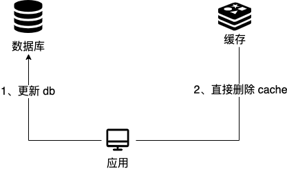
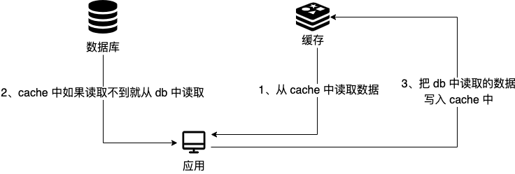
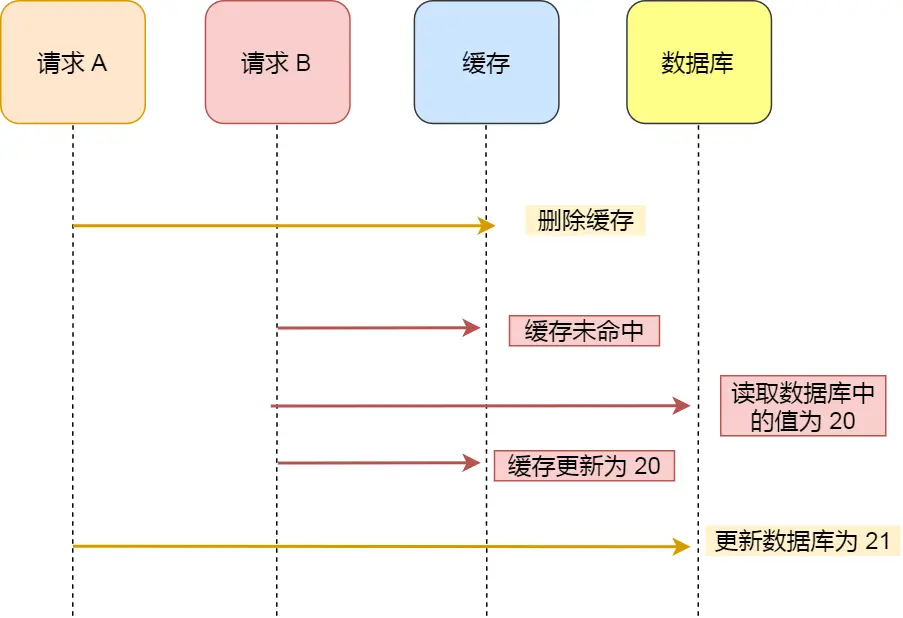
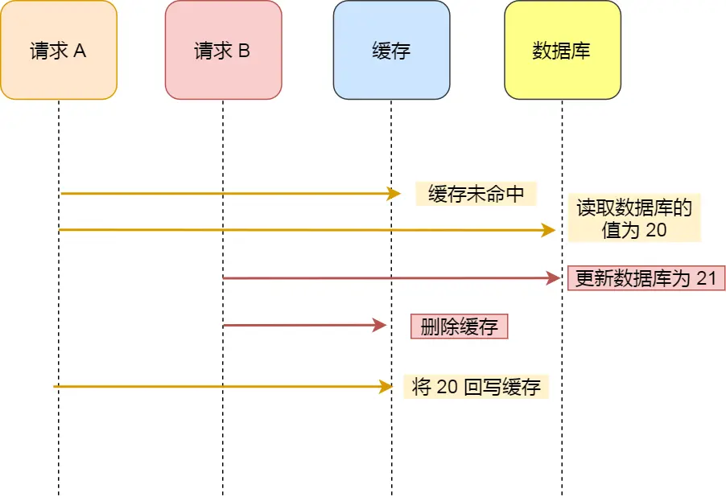
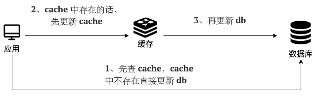
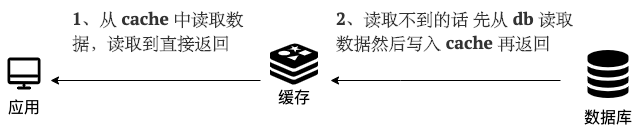

**读写策略又成为写入时策略，写入时策略有三种：**
1.读写穿透
2.旁路缓存
3.异步缓存写入

**读写穿透数据一致性更强，由缓存层内部保证写操作的原子性，缓存服务会原子性地完成对数据库的写入和本地缓存的更新，但是写必须通过缓存再到数据库，因此写延迟天然高于旁路缓存的直接写数据库**
**旁路缓存更加主流，因为对于海量互联网应用，写吞吐量是至关重要的指标。旁路缓存允许写请求“抄近道”，直接命中数据库，这是巨大的性能优势。并且如果缓存层宕机那么读写穿透模式下由于缓存层是唯一入口因此服务完全失效，但是旁路缓存只会全部落入数据库上**

# Cache Aside Pattern（旁路缓存） 应用中最常见
## 名词解释:
**旁路**：`因为缓存不是读写操作的必须经过路径`，而是“旁路”存在的。客户端在读写时可以直接操作数据库（DB），缓存只是辅助

读：先查缓存，miss则从DB读数据并由客户端手动更新缓存（缓存不直接参与DB访问）。

写：先更新DB，再删缓存（缓存不直接写入）。

**记忆点**：缓存像一条“旁路”，客户端可以绕过它与DB交互

---- 
CacheAsidePattern是我们平时使用比较多的一个缓存读写模式，比较适合读请求比较多的场景。
Cache AsidePattern中服务端需要同时维系db和cache，并且是以db的结果为准。

下面我们来看一下这个策略模式下的缓存读写步骤。
## 写：
- 先更新 db，然后直接删除cache
- 等第一次读该数据的操作时再将更新后的数据放到cache中

**问：**为什么是删除而不是直接更新到cache
**答：**删除一个数据，相比更新一个数据更加轻量级，用时更短，出现数据不一致的概率更小（在实际业务中，缓存的数据可能不是直接来自数据库表，也许来自多张底层数据表的聚合。） 

## 读：
- 从cache中读取数据，读取到就直接返回
- cache中读取不到的话，客户端就从db中读取数据返回给客户端，并由客户端把数据更新到cache中。

⭐**与读写穿透唯一不同**：读取不到数据时，`旁路缓存`是客户端读取db数据后由客户端更新db中的数据到cache，而读写穿透则是由cache服务自己更新db中的数据到cache并返回数据给客户端

## 在写数据的过程中，可以先删除 cache ，后更新 db 么？
不行，因为这样可能会造成 数据库（db）和缓存（Cache）数据不一致的问题
**例子：**
请求 A 要写操作更新用户年龄为 21，在更新过程中请求B读操作读取该用户的年龄

最终，该用户年龄在缓存中是 20（旧值），在数据库中是 21（新值），**缓存和数据库的数据不一致。**

--------------
⭐理论上来说更新 db后删cache还是可能会出现数据不一致性的问题（如下图）
**不过概率非常小，因为缓存的写入速度是比数据库的写入速度快很多。 所以在实际中很难出现请求 B 已经更新了数据库并且删除了缓存，请求 A 才更新完缓存的情况。**

## 旁路缓存缺陷
1.写操作比较频繁的话导致 cache 中的数据会被频繁被删除，这样会影响缓存命中率 。
**解决**：
`短暂允许数据不一致`：给缓存中的数据加一个比较短的过期时间，这期间存在缓存数据不一致，有过期时间来兜底，这样也能达到最终一致。
`数据库和缓存数据强一致`：在更新 db 的时候同样更新 cache，在更新 cache前先加个分布式锁，保证同一时间只运行一个请求更新 cache，

2.首次请求数据一定不在 cache 的问题（严格来说也不算缺陷，因为这样设计本身就是防止更新太慢导致数据不一致）

## 目前互联网常用策略是旁路缓存+延迟双删（这时候可以先删除缓存数据）

**Cache-Aside (Lazy-Loading) + 延迟双删** 是目前互联网应用中最常用、最基础的组合策略。

### 读流程 (Cache-Aside)：
1. **读取缓存**：先从缓存中读取数据
2. **缓存命中**：如果命中，直接返回数据
3. **缓存未命中**：如果未命中，从数据库读取数据
4. **更新缓存**：将从数据库读取的数据写入缓存，然后返回给客户端

### 写流程 (延迟双删)：
1. **第一次删除缓存**：先删除缓存中的数据
2. **更新数据库**：更新数据库中的数据
3. **延迟删除缓存**：延迟一段时间（如几百毫秒），再次删除缓存

### 为什么需要延迟双删？

#### 问题场景分析：
- **第一步删除缓存**：为了在更新期间，让后续的读请求不能命中缓存，从而去读数据库获取最新数据
- **第二步更新数据库**：完成数据的实际更新
- **第三步延迟删除**：清除在"更新数据库"这个时间窗口内，可能被其他读请求加载到缓存中的旧数据

⚠️ **注意**：虽然这个时间窗口很小，但在超高并发场景下仍可能出现数据不一致的情况。

### 优点：
- ✅ **实现简单**：是Cache-Aside模式的自然延伸，易于理解和实现
- ✅ **解决大部分不一致问题**：特别是"先更新数据库再更新缓存"策略中的缓存更新失败问题
- ✅ **适用性广**：适合大多数互联网应用场景

### 缺点：
- ⚠️ **仍存在极小概率的数据不一致**：在极高并发下，延迟删除的时间窗口内仍可能出现问题
- ⚠️ **需要合理设置延迟时间**：延迟时间过短可能无效，过长会影响性能

# Read/Write Through Pattern（读写穿透）
## 名词解释
**读写穿透**：`因为读写操作都必须先通过缓存`，然后缓存再直接与DB交互，但缓存服务负责同步更新：
读：先从缓存查询，miss时，缓存服务自动从DB读取数据并更新缓存（数据“穿透”缓存到DB）。
写：更新缓存后，缓存服务同步更新DB（数据“穿透”缓存到DB）。

记忆点：缓存像一层“透明膜”，读写都必须通过它，但它会自动“穿透”到DB同步数据，对客户端透明。

## 写（Write Through）：
先查 cache
- cache 中存在，则先更新 cache，然后 cache 服务将数据更新到 db（同步更新 cache 和 db）。
- cache中不存在，直接更新 db。

## 读(Read Through) ：
从 cache 中读取数据
- 读取到就直接返回 。
- 读取不到的话，cache直接从db读取 并由cache自己将db中的数据同步更新到 cache 后返回响应。

⭐**与旁路缓存唯一不同**：读取不到数据时，`旁路缓存`是客户端读取db数据后由客户端更新db中的数据到cache，而读写穿透则是由cache服务自己更新db中的数据到cache并返回数据给客户端

# Write Behind Pattern（异步缓存写入）
**异步缓存写入**和**读写穿透**很相似，两者都是由 cache 服务来负责cache 和 db
的读写。

## 两个又有很大的不同：
**读写穿透**是同步更新cache和db，而**异步缓存写入**则是
只更新缓存，不直接更新db，而是改为后台异步批量的方式来更新db。

很明显，这种方式对数据一致性带来了更大的挑战，比如cache数据可能还没异步更新db的话，cache服
务可能就就挂掉了。

这种策略在我们平时开发过程中也非常非常少见，但是不代表它的应用场景少，比如消息队列中消息的异步
写入磁盘、MySQL的InnodbBufferPool机制都用到了这种策略。

**异步缓存写入**下db的写性能非常高，非常适合一些数据经常变化又对数据一致性要求没那么高的
场景，比如浏览量、点赞量。

| 模式类型                               | 写操作逻辑                                                                            | 读操作逻辑                                                         | 特点与优缺点                                                                                                                         | 典型应用场景                                   |
| -------------------------------------- | ------------------------------------------------------------------------------------- | ------------------------------------------------------------------ | ------------------------------------------------------------------------------------------------------------------------------------ | ---------------------------------------------- |
| **Cache Aside** （旁路缓存）        | 1. 先更新数据库 2. 删除缓存 3. 下次读取时再加载到缓存                           | 1. 先读缓存 2. 若未命中，再读数据库并**由客户端**将结果写入缓存 | ✅ 适合**读多写少**场景 ✅ 避免写入过多造成缓存压力 ⚠️ 数据一致性靠流程控制 ⚠️ **写操作多时命中率下降** ⚠️ 首次读取必定不命中 | 高并发读请求，如商品详情、用户资料页等         |
| **Read/Write Through** （读写穿透） | 1. 先更新缓存 2. 缓存服务同步更新数据库 3. 如果缓存中没有该数据，直接更新数据库 | 1. 读缓存 2. 若未命中，由**缓存服务**从数据库中加载并更新缓存   | ✅ 一致性好（由缓存服务控制） ✅ 对客户端透明 ⚠️ 写入路径复杂，缓存服务压力大 ⚠️ 若缓存服务异常影响更广泛                       | 中等写频率，读写较均衡系统，如电商后台管理系统 |
| **Write Behind** （异步缓存写入）   | 1. 只更新缓存 2. 缓存服务**异步批量写数据库**                                      | 与读写穿透类似，先读缓存；未命中则由缓存服务加载并更新缓存         | ✅ 写吞吐量极高 ✅ 支持大批量数据更新 ⚠️ 一致性最差（异步写入有延迟） ⚠️ 缓存服务崩溃易导致数据丢失                             | 非强一致性场景，如点击量、点赞量统计、日志系统 |

