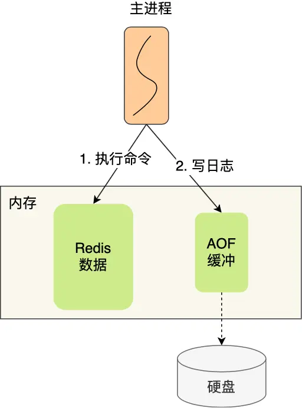
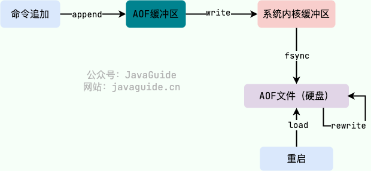
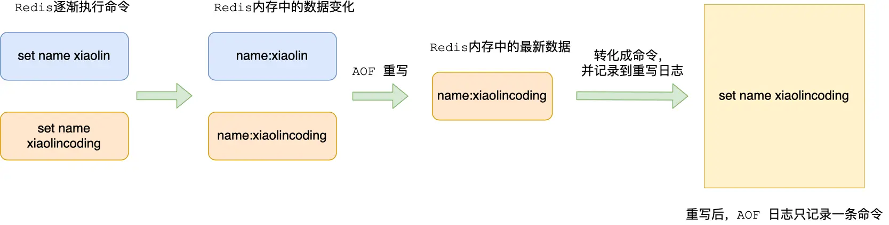
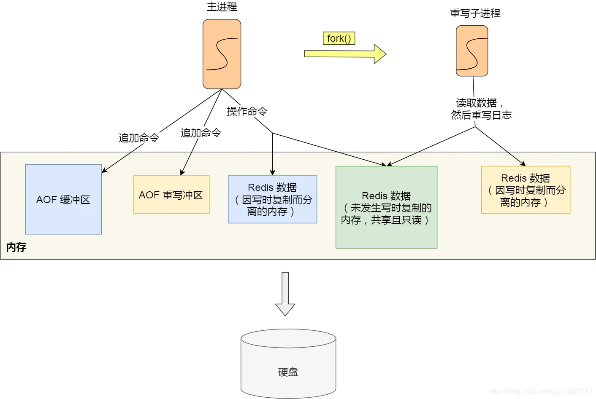
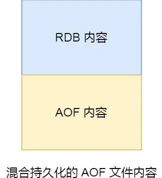

⭐ **Redis 支持 3 种持久化方式**:
- RDB快照（snapshotting）
- AOF只追加文件（append-only file）
- RDB与AOF的混合持久化(Redis 4.0 新增)

| 持久化方式     | 优点                                                                   | 缺点                                                                     |
| -------------- | ---------------------------------------------------------------------- | ------------------------------------------------------------------------ |
| **RDB**        | - 恢复速度快（直接加载二进制数据到内存）<br>- 文件体积小，压缩高效     | - 全量备份，持久化性能开销较大<br>- 因为开销大导致频率低，丢失数据更频繁 |
| **AOF**        | - 数据丢失少（增量备份，性能开销小，支持实时或每秒写入）               | - 恢复速度慢（需重放命令）<br>- 文件会变大，需定期重写优化               |
| **混合持久化** | - 恢复速度快（前半为 RDB 数据）<br>- 数据丢失少（后半为 AOF 增量命令） | - 实现复杂度高<br>- 仅在 AOF 重写时生效，适用场景较有限                  |


**必看**⭐Redis 的核心命令处理是`单线程`的（即主线程处理客户端请求），但为了性能和可靠性，Redis 会使用`子进程`（通过 fork()）来处理持久化任务，从而避免阻塞`主线程`。
**`主进程` → 有且只有一个`主线程`**
**`主进程`通过fork → `子进程`**

# AOF仅追加文件持久化(持久化`执行命令`)
Redis 6.0 之后默认是开启了，也可以通过 `appendonly` 参数开启
## 持久化执行步骤
在Redis主线程上进行，所有当执行完操作命令之后才开始进行AOF持久化，这样有以下好处
- 不会阻塞当前的命令执行（关系型数据库（如 MySQL）通常都是执行命令完成之前记录日志，如binlog）
- 避免额外的检查开销，只有在该命令执行成功后，才将命令记录到 AOF 日志里


### AOF持久化功能的实现可以简单分为5步：
- **1.命令追加(append)**：所有的写命令会追加到AOF缓冲区中。
- **2.文件写入(write)**：将AOF缓冲区的数据写入到AOF文件中。这一步需要调用write函数(系统调用)，write 将数据写入到了系统内核缓冲区之后直接返回了(延迟写)。注意！！！此时并没有同步到磁盘。
- **3.文件同步(fsync)**：AOF 缓冲区根据对应的持久化方式（fsync 策略）向硬盘做同步操作。这一步需要调用fsync函数(系统调用)，fsync 针对单个文件操作，对其进行强制硬盘同步，fsync 将阻塞直到写入磁盘完成后返回，保证了数据持久化。
- **4.文件重写(rewrite)**：随着AOF文件越来越大，需要定期对AOF文件进行重写，达到压缩的目的。
- **5.重启加载(load)**：当Redis重启时，可以加载AOF文件进行数据恢复。


## 文件同步(fsync)三种策略：控制数据同步到硬盘的时机
在 `redis.conf` 配置文件中的 `appendfsync` 配置项可以有以下 3 种参数可填：
- `Always`，这个单词的意思是「总是」，所以它的意思是每次写操作命令执行完后，同步将AOF 日志数据持久化到硬盘;
- `Everysec`，这个单词的意思是「每秒」，所以它的意思是每次写操作命令执行完后，先将命令写入到AOF文件的内核缓冲区，然后每隔一秒将缓冲区里的内容持久化到到硬盘；
- `No`，意味着不由Redis控制写回硬盘的时机，转交给操作系统控制写回的时机，也就是每次写操作命令执行完后，先将命令写入到AOF文件的内核缓冲区，再由操作系统决定何时将缓冲区内容持久化到硬盘。

## 文件重写机制
AOF 日志是一个文件，随着执行的写操作命令越来越多，文件的大小会越来越大。Redis为了避免AOF文件越写越大，提供了AOF 重写机制，当AOF文件的大小超过所设定的阈值后，Redis 就会启用AOF重写机制，来压缩AOF文件。
### 重写方式
由于重写过程耗时，为了阻塞导致 Redis 正常处理命令请求造成影响，所以**Redis 的重写 AOF 过程是由后台fork一个子进程 bgrewriteaof 来完成的**

重写时会将旧的AOF文件中的执行命令压缩写入到新的AOF文件，完成重写后新的AOF文件覆盖旧的AOF文件（`这样做是防止 AOF 重写过程中失败了，现有的 AOF 文件造成污染无法用于恢复`）

因为AOF记录的是执行的命令，因此重写时可以对同一字段的操作命令按照先后顺序进行压缩
举个例子，在没有使用重写机制前，假设前后执行了`set name xiaolin`和`set name xiaolincoding`两个命令的话，就会将这两个命令都记录到AOF文件。通过重写便只保存了最新的命令


## 重写过程
fork一个重写`子进程`并且创建一个`AOF重写缓冲区`：
- **子进程**：防止阻塞主进程
- **AOF重写缓冲区**：防止重写期间有新的写入命令到来导致子进程的内存数据就跟主进程的内存数据不一致，导致最终新的AOF文件中没有重写期间新的redis写入命令

为了节约物理内存资源，主进程和子进程共享同一片物理内存的redis数据进行`读操作`，当有新的redis命令进行`写操作`时才会通过写时复制`将要修改的redis数据的物理内存分离成新的副本`。


### 主进程
- 执行客户端新发来的命令;
- 将执行后的写命令追加到`AOF缓冲区`;
- 将执行后的写命令追加到`AOF重写缓冲区`；


### 子进程
扫描数据库中所有数据，逐一把内存数据的键值对转换成一条命令，再将命令记录到新的AOF日志
当新的AOF文件重写完成之后子进程会向主进程发送完成信号，主进程会调用一个信号处理函数

### 信号处理函数
- 将AOF 重写缓冲区中的所有内容写入到新的 AOF 的文件中，使得新旧两个 AOF 文件所保存的数据库状态一致;
- 新的 AOF 的文件覆盖现有的 AOF 文件。


# RDB快照持久化（持久化`二进制数据`）
RDB快照记录了redis某一个瞬间的所有内存数据（`全量快照`），记录的是实际数据。与AOF仅记录执行的命令不同
**优点**：在 Redis 恢复数据时，`RDB 恢复数据的效率会比 AOF 高`，因为直接将 RDB 文件读入内存就可以，而AOF还需要执行额外的操作命令
**缺点**：与AOF每次新增一条执行命令的增量数据不同，RDB快照是全量快照，因此每次持久化都是把内存中的「所有数据」都记录到磁盘中，这是一个很重的操作，因此RBD持久化频率不会很高
## 持久化方式
Redis 提供了两个命令来生成 RDB 文件，分别是save和bgsave，他们的区别就在于是否在「主进程」
里执行：
`bgsave 命令`，会创建一个子进程来进行持久化(默认选项)
`save命令`：在主进程进行持久化

**注意：以下实际都是bgsave 命令**
``` command
save 900 1           #在900秒(15分钟)之后，如果至少有1个key发生变化，Redis就会自动触发bgsave命令创建快照。

save 300 10          #在300秒(5分钟)之后，如果至少有10个key发生变化，Redis就会自动触发bgsave命令创建快照。

save 60 10000        #在60秒(1分钟)之后，如果至少有10000个key发生变化，Redis就会自动触发bgsave命令创建快照。

```

**与AOF一样，子进程和主进程也同样共享内存数据，同样会发生写时复制，不再赘述**


**但是**，因为没有类似与AOF重写缓冲区的机制，导致bgsave 快照持久化过程中，如果有新的写入操作导致主进程修改了共享数据发生了写时复制，但是RDB
快照保存的只是是原本的内存数据，主进程刚修改的数据，是没办法在这依次RDB持久化写入RDB文件的，只能交由下一次的 RDB持久化。


# RDB与AOF的混合持久化(针对AOF重写时期-AOF文件中：前半部分是 RDB 格式的全量数据，后半部分是 AOF 格式的增量数据)
⭐**混合持久化工作在 AOF 日志重写过程**
该持久化结合了 RDB 恢复速度快的优点和 AOF 丢失数据少的优点

当开启了混合持久化时，在 AOF 重写日志时，fork出来的重写子进程会先将与主进程共享的内存数据
以RDB方式写入到AOF文件，然后将重写期间重写缓冲区里中新记录的主进程处理的操作命令以AOF方式写入到AOF文件，写入完成后通知主进程程将新的AOF
文件（同时含有RDB 格式和AOF格式的内容）替换旧的的AOF文件。

`也就是开启了混合持久化后还是使用AOF持久化，只是AOF文件的前半部分是RDB格式的全量数据，后半部分是AOF格式的增量数据。`
这样的好处在于，重启 Redis 加载数据的时候，**由于前半部分是 RDB 内容，这样加载的时候速度会很快。加载完RDB的内容后，会加载后半部分的AOF内容，AOF持久化又保证了持久化的频率更高，丢失的数据更少**  这里的AOF的内容是Redis后台子进程重写AOF期间，主进程处理的操作命令。





