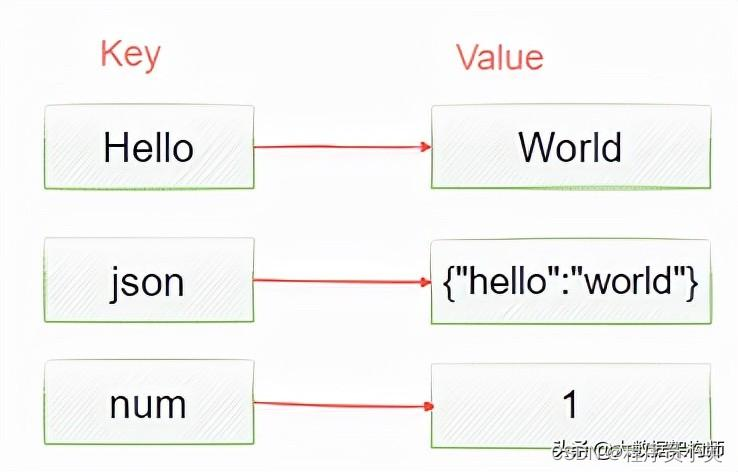
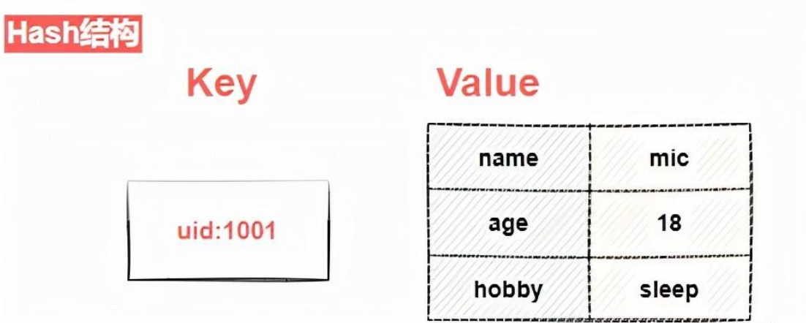
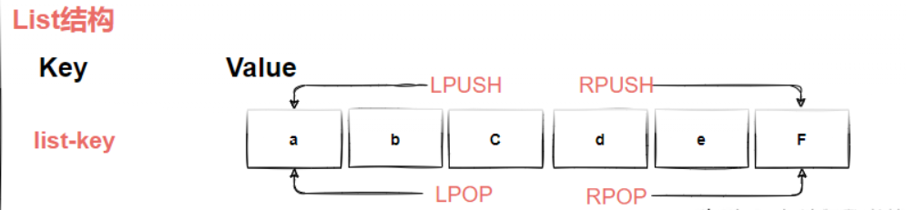
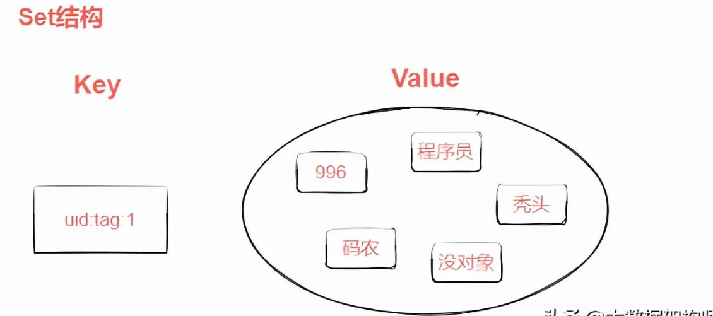
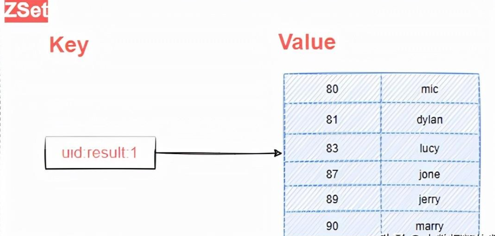
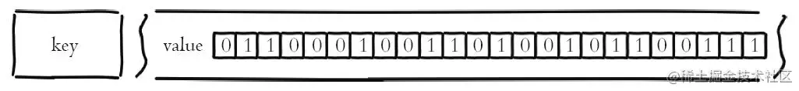

# Redis 主要支持以下几种抽象数据类型：**

下面这些都是对外暴露给用户的「抽象数据类型」，它们内部都会映射到一个或多个底层数据结构上。

## string（字符串）

- **说明**：最基础的数据类型，底层本质是一个字节数组，可存储普通字符串、整数、浮点数等。
- **典型底层结构**：简单动态字符串 `SDS`。
- **最经典的存取命令**：
  - `SET key value`：设置一个 key 的值。
  - `GET key`：获取一个 key 的值。
  - `INCR key`：将 key 对应的整数值加 1，用于计数。
- **时间复杂度（常见操作）**：
  - `SET`、`GET`、`INCR`、`DECR`：O(1)
  - 部分范围操作如 `GETRANGE`、`SETRANGE`：按长度 O(n)
- **典型场景**：
  - 缓存热点数据（对象序列化为 JSON / 二进制）
  - 计数器（浏览量、点赞数等）
  - 分布式锁（基于 `SET key value NX PX`）

## hash（哈希）

- **说明**：类似于「键值对集合」，适合在一个 key 下存储多个字段，如一个用户对象的多项属性。
- **典型底层结构**：
  - 元素个数少且字段名/值较短时：`ziplist`（新版本使用 `listpack`）
  - 元素多或字段较长时：`dict`（哈希表）
- **最经典的存取命令**：
  - `HSET key field value`：设置哈希表中某个字段的值。
  - `HGET key field`：获取哈希表中某个字段的值。
  - `HGETALL key`：获取哈希表中所有字段和值（慎用在字段很多时）。
- **时间复杂度（常见操作）**：
  - 单字段读写：平均 O(1)
  - 遍历：O(n)
- **典型场景**：
  - 存储结构化对象（用户、商品信息）
  - 需要对单个字段增量更新（如余额、积分）

## list（列表）

- **说明**：按插入顺序排序的字符串列表，支持两端插入/弹出，是一个双端队列抽象.
- **典型底层结构**：
  - 早期：`linkedlist`、`ziplist`
  - 新版本：统一为 `quicklist`（压缩列表 + 链表混合结构）
- **最经典的存取命令**：
  - `LPUSH key value`：从左侧插入一个元素。
  - `RPUSH key value`：从右侧插入一个元素。
  - `LPOP key` / `RPOP key`：从左/右弹出一个元素，常用于队列/栈模型。
  - `LRANGE key start stop`：按下标范围读取列表，用于分页查看。
- **时间复杂度**：
  - 头尾入队/出队：O(1)
  - 按下标随机访问、插入：O(n)
- **典型场景**：
  - 消息队列（简单队列、任务列表）
  - 时间轴（如按时间记录操作日志）

## set（集合）

- **说明**：无序、元素唯一的字符串集合，提供交集、并集、差集等集合运算.
- **典型底层结构**：
  - 整数元素且数量较少：`intset`
  - 其他情况：`dict`（哈希表，value 统一为 null）
- **最经典的存取命令**：
  - `SADD key member`：向集合添加一个元素。
  - `SISMEMBER key member`：判断元素是否在集合中。
  - `SMEMBERS key`：获取集合中所有元素，小集合调试时常用。
- **时间复杂度**：
  - 单元素增加/删除/判断：平均 O(1)
  - 交并差等运算：O(n)（与参与集合中元素数量有关）
- **典型场景**：
  - 标签、兴趣、关注集合
  - 去重统计（如今日在线 IP 集合）

## zset（sorted set，有序集合）

- **说明**：在 set 的「去重」基础上，每个元素多一个 `score`（浮点数），按 score 有序，可按分数或排名范围查询.
- **典型底层结构**：
  - 跳表 `skiplist` + `dict` 同时维护
- **最经典的存取命令**：
  - `ZADD key score member`：向有序集合中添加一个带分数的成员。
  - `ZSCORE key member`：获取某成员的分数。
  - `ZRANGE key start stop WITHSCORES`：按升序获取指定排名区间及分数，用于排行榜正序。
  - `ZREVRANGE key start stop WITHSCORES`：按降序获取指定排名区间，用于排行榜倒序（最常见）。
- **时间复杂度**：
  - 插入、删除、按 score 查找：O(log N)
  - 按排名/分数范围遍历：O(log N + m)，m 为返回元素个数
- **典型场景**：
  - 排行榜（积分、热度、权重排序）
  - 延时队列（score 作为时间戳）

## 位图（Bitmaps）

- **说明**：本质上是对 string 类型「逐位」操作，把一个字符串看作比特数组进行设置和查询.
- **典型底层结构**：`SDS`（string），额外提供按 bit 操作的命令.
- **最经典的存取命令**：
  - `SETBIT key offset value`：设置某个偏移位是 0/1，用来标记用户在某天是否活跃。
  - `GETBIT key offset`：获取某一位是否为 1。
  - `BITCOUNT key`：统计整个位图中 1 的个数，用于活跃用户数统计。
- **典型场景**：
  - 用户签到、活跃标记（某天是否做过某事）
  - 布隆过滤器等位运算的基础

## HyperLogLog（超日志）

- **说明**：一种用于**基数统计**的概率型数据结构，可估算集合中唯一元素数量，误差率约 0.81%.
- **典型底层结构**：HyperLogLog 专用结构，基于 string 存储.
- **最经典的存取命令**：
  - `PFADD key element...`：向 HyperLogLog 中添加一个或多个元素。
  - `PFCOUNT key`：估算去重后的元素数量（如估算 UV）。
- **典型场景**：
  - UV 统计（独立访客数量）
  - 大规模去重计数，对准确率要求不极高的场景

## Geospatial（地理空间）

- **说明**：用于存储地理位置信息（经纬度）并支持距离、范围查询.
- **典型底层结构**：基于 `zset` 封装，将经纬度编码为 `score`.
- **最经典的存取命令**：
  - `GEOADD key longitude latitude member`：添加一个带经纬度的地点。
  - `GEODIST key member1 member2`：计算两个地点之间的距离。
  - `GEORADIUS key longitude latitude radius m|km`：以某点为圆心按半径查找附近地点。
- **典型场景**：
  - 附近的人/店铺
  - LBS 相关应用

## Pub/Sub（发布/订阅）

- **说明**：一种消息通信模式，发布端向频道发布消息，订阅端实时接收；消息不落盘，只有在线订阅者能收到.
- **典型底层结构**：内部维护**频道 → 订阅者列表**的映射结构，多用链表/字典等组合.
- **最经典的存取命令**：
  - `SUBSCRIBE channel`：订阅一个频道，等待消息。
  - `PUBLISH channel message`：向频道发送一条消息，所有订阅者都会收到。
- **典型场景**：
  - 简单实时通知、聊天室
  - 不需要持久化的即时消息

## Streams（流）

- **说明**：日志型消息队列结构，支持持久化、消费组、多消费者、按时间/ID 有序读取.
- **典型底层结构**：压缩列表 / listpack + 辅助索引结构.
- **最经典的存取命令**：
  - `XADD key * field value`：向流中追加一条消息，`*` 表示自动生成消息 ID。
  - `XREAD COUNT n STREAMS key id`：从指定流中读取消息，常用 `0` 或上次 ID 开始。
  - 使用消费组时：`XREADGROUP GROUP group consumer STREAMS key id` 读取并消费消息。
- **典型场景**：
  - 消息队列（MQ 替代或补充）
  - 日志采集、事件流处理

## Modules（模块）

- **说明**：Redis 支持通过模块机制扩展新的数据类型和命令，如 Bloom Filter、JSON、TimeSeries 等.
- **底层结构**：由模块自行实现，可复用 Redis 内部结构，也可以自定义.

# Redis 主要底层数据结构：

Redis 的抽象数据类型最终都会落到少数几种底层结构上，这些底层结构是理解性能与内存行为的关键.

- **SDS（Simple Dynamic String，简单动态字符串）**
  - 动态扩容的字符数组，记录长度和已分配空间，避免频繁 `strlen`.
  - 支撑 `string` 类型及很多内部编码.

- **dict（哈希表）**
  - 键值对存储结构，支持渐进式 rehash，常数级查找性能.
  - 用于数据库 key 空间、`hash` 类型、`set` 等.

- **ziplist / listpack（压缩列表）**
  - 连续内存块，适合元素数量少且短小的场景，空间利用率高.
  - 用于小型 `list`、`hash`、`zset` 等的紧凑编码.

- **quicklist**
  - 多个小的 ziplist/listpack 组成的双向链表，结合了连续内存和链表的优势.
  - 作为 `list` 类型的主要底层实现.

- **intset（整数集合）**
  - 按序存储整型元素的有序数组，去重且可升级存储位宽.
  - 用于小型整数 `set`.

- **skiplist（跳表）**
  - 多层有序链表结构，支持 O(log N) 插入、删除、查找.
  - 主要用作 `zset` 的有序部分.

# 数据类型与底层数据结构的关系

同一种抽象数据类型，在不同条件下可能会使用不同的底层结构（编码），Redis 会自动在它们之间转换以平衡**空间**和**时间**.

## 映射总览

- **string**
  - 底层结构：`SDS`

- **hash**
  - 元素少且字段/值短：`ziplist` / `listpack`
  - 元素多或字段/值长：`dict`

- **list**
  - 统一：`quicklist`（内部包含多个 `ziplist/listpack` 节点）

- **set**
  - 小整数集合：`intset`
  - 一般字符串集合：`dict`

- **zset（有序集合）**
  - 元素少且成员/score 较小：`ziplist` / `listpack`
  - 一般情况：`skiplist` + `dict` 组合

- **Bitmaps**
  - 本质是对 `string`（SDS）的 bit 级操作

- **HyperLogLog**
  - 特殊编码结构，存放在 `string` 内部

- **Geospatial**
  - 基于 `zset`（score 存地理编码）

- **Pub/Sub**
  - 用多个 `dict`、链表等组合维护频道与订阅者关系

- **Streams**
  - 基于压缩列表 / listpack 实现的日志结构 + 辅助索引

## 设计与使用上的几点理解

- **抽象类型更偏向于“接口语义”**：面向用户的使用方式和命令集合.
- **底层结构更偏向于“性能与存储实现”**：为了在不同规模和场景下兼顾性能和内存，Redis 会动态选择/转换编码.
- 在设计 key 时，既要考虑抽象类型是否满足功能需求，也要理解其底层结构在大规模数据下的性能特征.
