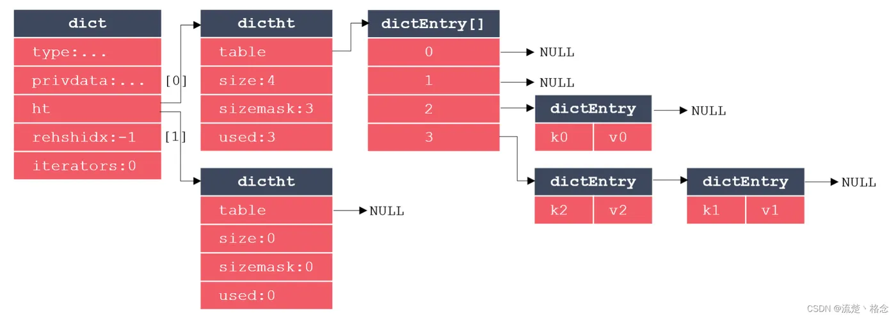
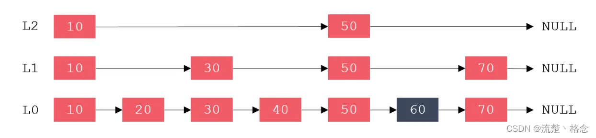
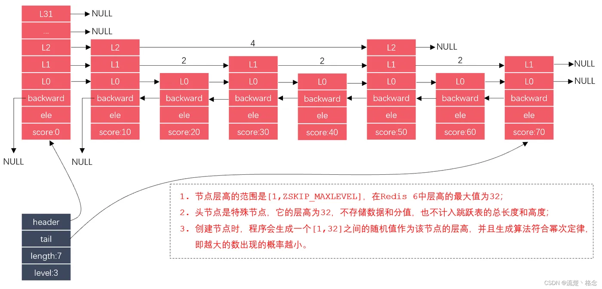

[参考](https://developer.aliyun.com/article/1346862)

**常见使用场景：**
- 设计一个百万级数据量的实时排行榜
## 有序集合（Sorted Set）编码方案
有序集合对象有2种编码方案，当同时满足以下条件时，集合对象采用ziplist编码，否则采用skiplist编码：
• 有序集合保存的元素数量不超过128个；
• 有序集合保存的所有元素的成员长度都小于64字节。
ziplist编码的有序集合采用压缩列表作为底层实现
**skiplist编码的有序集合采用zset结构作为底层实现**。
**zset**是一个复合结构，它的内部采用字典和跳跃表来实现，其源码如下：
```c
typedef struct zset { 
    dict *dict;     // 字典，保存了从成员到分值的映射关系； 
    zskiplist *zsl; // 跳跃表，按分值由小到大保存所有集合元素； 
} zset;
```
**其中成员：**
- `dict *dict`: 一个字典，用于存储元素到分数的映射，并保证元素的唯一性。字典的键是元素（ele），值是分数（score）。
- `zskiplist zsl`: 一个跳跃表，用于根据分数对元素进行排序。跳跃表中的每个节点都包含了一个元素及其对应的分数。
这样，当按照成员来访问有序集合时可以直接从dict中取值，当按照分值的范围访问有序集合时可以直接从zsl中取值，采用了空间换时间的策略以提高访问效率。
综上，**zset对象的底层数据结构包括：压缩列表、字典(散列表)、跳跃表。**

下面着重介绍字典(哈希表)和跳跃表

## hashtable：字典(散列表)

Redis字典的实现主要涉及三个结构体：字典、哈希表、哈希表节点。其中，每个哈希表节点保存一个键值对，每个哈希表由多个哈希表节点构成，而字典则是对哈希表的进一步封装。
这三个结构体的关系如下图所示
其中，**dict代表字典**，**dictht代表哈希表**，**dictEntry代表哈希表节点**。
可以看出，dictEntry是一个数组，这很好理解，因为一个哈希表里要包含多个哈希表节点。而dict里包含2个dictht，多出的哈希表用于REHASH。


**REHASH请见置顶参考**

## skiplist：跳跃表
跳跃表的查找复杂度为平均O(logN)，最坏O(N)，效率堪比红黑树，却远比红黑树实现简单。跳跃表是在链表的基础上，通过增加索引来提高查找效率的。
有序链表插入、删除的复杂度为O(1)，而查找的复杂度为O(N)。例：若要查找值为60的元素，需要从第1个元素依次向后比较，共需比较6次才行，如下图：


跳跃表是从有序链表中选取部分节点，组成一个新链表，并以此作为原始链表的一级索引。再从一级索引中选取部分节点，组成一个新链表，并以此作为原始链表的二级索引。以此类推，可以有多级索引,跃表在查找时，优先从高层开始查找，若next节点值大于目标值，或next指针指向NULL，则从当前节点下降一层继续向后查找，这样便可以提高查找的效率了。


跳跃表的实现主要涉及2个结构体：zskiplist、zskiplistNode，它们的关系如下图所示：


其中，蓝色的表格代表zskiplist，红色的表格代表zskiplistNode：
• `zskiplist`有指向头尾节点的指针，以及列表的长度，列表中最高的层级。
• `zskiplistNode`的头节点是空的，它不存储任何真实的数据，它拥有最高的层级，但这个层级不记录在zskiplist之内。